

  <picture>
    <source media="(prefers-color-scheme: dark)" srcset="assets/artista.svg"/>
    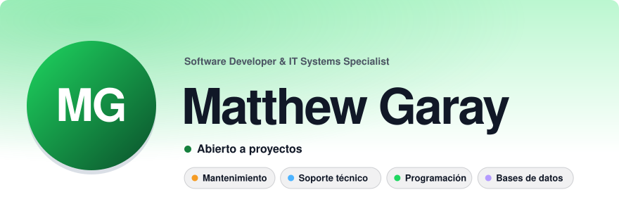
  </picture>

  
  &nbsp;&nbsp;
  

  <picture>
    <source media="(prefers-color-scheme: dark)" srcset="assets/acerca.svg"/>
    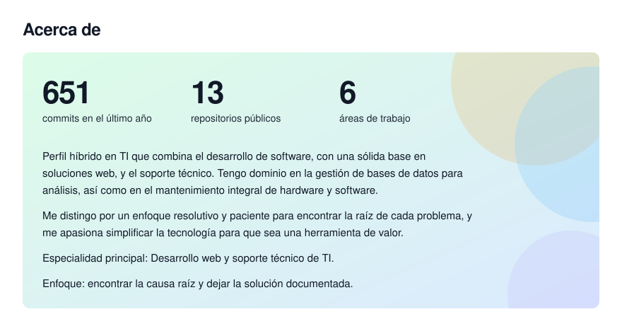
  </picture>

  <picture>
    <source media="(prefers-color-scheme: dark)" srcset="assets/playlist.svg"/>
    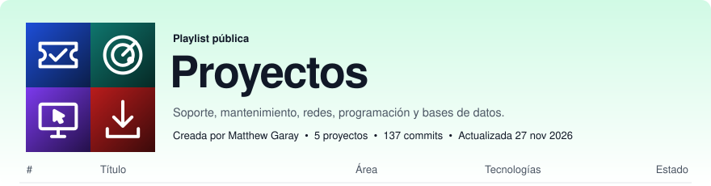
  </picture>

  <a href="https://github.com/Matthew-Garay/Precision-Truck-Parts---Help-Desk" title="Abrir Precision HelpDesk">
  <picture>
      <source media="(prefers-color-scheme: dark)" srcset="assets/pista-01.svg"/>
      
    </picture>
  </a>

  <a href="https://github.com/Matthew-Garay/IP-Scanner" title="Abrir IP Inspector">
  <picture>
      <source media="(prefers-color-scheme: dark)" srcset="assets/pista-02.svg"/>
      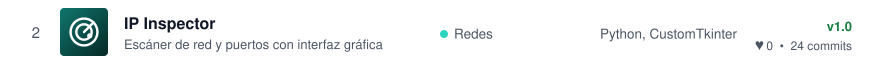
    </picture>
  </a>

  <a href="https://github.com/Matthew-Garay/Cerberus" title="Abrir Cerberus">
  <picture>
      <source media="(prefers-color-scheme: dark)" srcset="assets/pista-03.svg"/>
      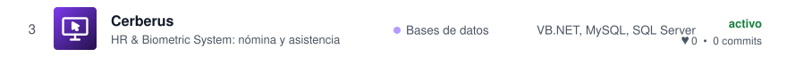
    </picture>
  </a>

  <a href="https://github.com/Matthew-Garay/Microsoft-Office-Installer" title="Abrir Microsoft Office Installer">
  <picture>
      <source media="(prefers-color-scheme: dark)" srcset="assets/pista-04.svg"/>
      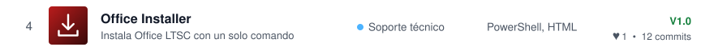
    </picture>
  </a>

  <a href="https://github.com/Matthew-Garay/Adobe-Genuine-Service-AGS-Alert" title="Abrir Adobe AGS Alert">
  <picture>
      <source media="(prefers-color-scheme: dark)" srcset="assets/pista-05.svg"/>
      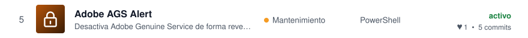
    </picture>
  </a>

  <picture>
    <source media="(prefers-color-scheme: dark)" srcset="assets/discografia.svg"/>
    
  </picture>

  <a href="https://github.com/Matthew-Garay/MG-Toolkit"><picture><source media="(prefers-color-scheme: dark)" srcset="assets/album-1.svg"/>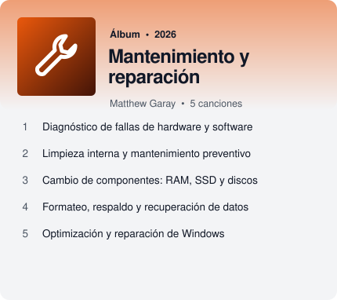</picture></a>
  <a href="https://github.com/Matthew-Garay/Microsoft-Office-Installer"><picture><source media="(prefers-color-scheme: dark)" srcset="assets/album-2.svg"/>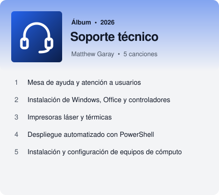</picture></a>

  <a href="https://github.com/Matthew-Garay/qr-studio"><picture><source media="(prefers-color-scheme: dark)" srcset="assets/album-3.svg"/>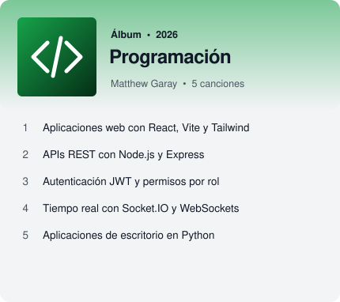</picture></a>
  <a href="https://github.com/Matthew-Garay/Precision-Truck-Parts---Help-Desk"><picture><source media="(prefers-color-scheme: dark)" srcset="assets/album-4.svg"/>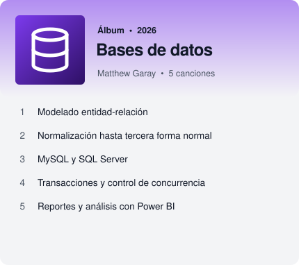</picture></a>

  <a href="https://github.com/Matthew-Garay/IP-Scanner"><picture><source media="(prefers-color-scheme: dark)" srcset="assets/album-5.svg"/>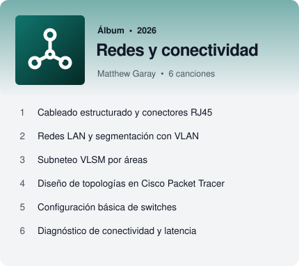</picture></a>
  <a href="https://github.com/Matthew-Garay/Adobe-Genuine-Service-AGS-Alert"><picture><source media="(prefers-color-scheme: dark)" srcset="assets/album-6.svg"/></picture></a>

  <picture>
    <source media="(prefers-color-scheme: dark)" srcset="assets/creditos.svg"/>
    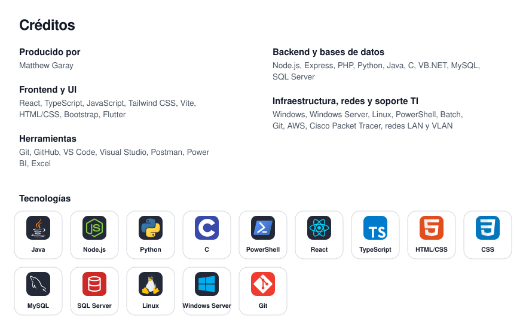
  </picture>

  <picture>
    <source media="(prefers-color-scheme: dark)" srcset="assets/actividad.svg"/>
    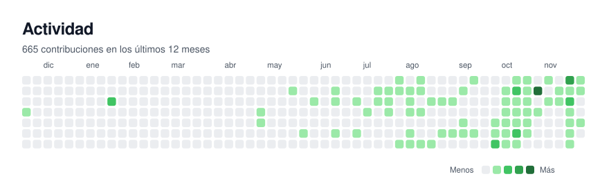
  </picture>

  <picture>
    <source media="(prefers-color-scheme: dark)" srcset="assets/resumen.svg"/>
    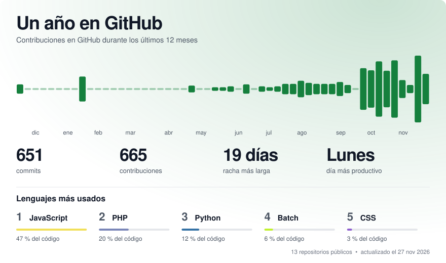
  </picture>

  <picture>
    <source media="(prefers-color-scheme: dark)" srcset="assets/contacto.svg"/>
    
  </picture>

  
  &nbsp;&nbsp;&nbsp;
  
  &nbsp;&nbsp;&nbsp;
  

  <picture>
    <source media="(prefers-color-scheme: dark)" srcset="assets/barra.svg"/>
    
  </picture>

