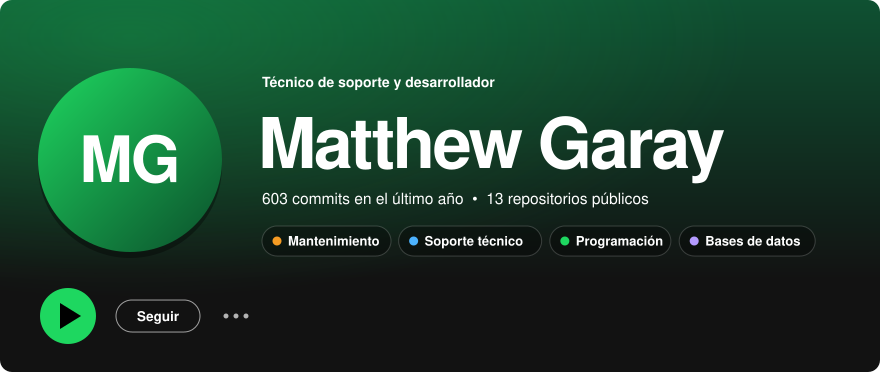
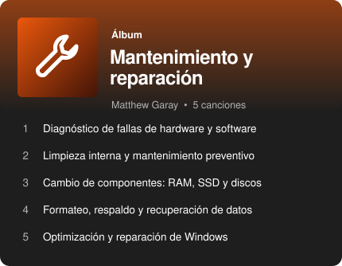
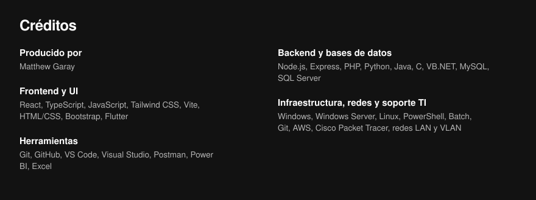

  

  

  
  
  
  
  
  

  

  
  
  
  

  

  

  
  &nbsp;&nbsp;&nbsp;&nbsp;
  
  &nbsp;&nbsp;&nbsp;&nbsp;
  

  1911.garay.perez@gmail.com &nbsp;•&nbsp; linkedin.com/in/matthewgarayperez &nbsp;•&nbsp; github.com/Matthew-Garay

  

  

  

  

  

