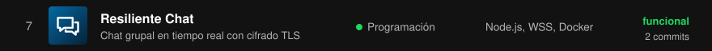
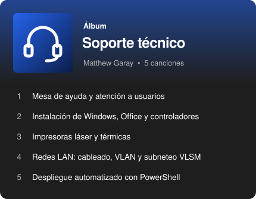
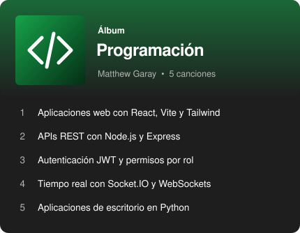
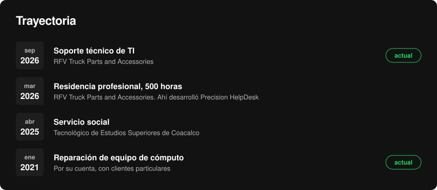
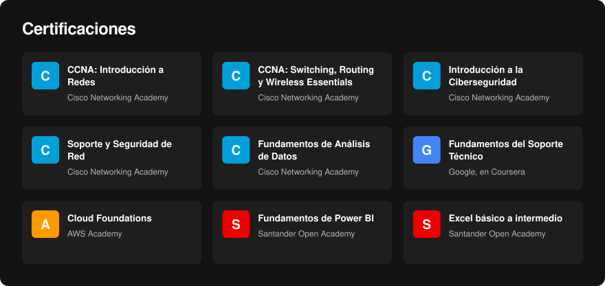

  

  

  

Lo desarrolló durante su residencia en RFV Truck Parts. Ahí los reportes de fallas llegaban por mensajes y hojas de cálculo, y no había un inventario confiable de los equipos de cada área.

Con el sistema, cada empleado levanta su ticket con fotos de la falla, pide insumos y consulta manuales. El área de TI asigna y sigue los tickets, lleva el inventario de hardware y software y saca reportes en PDF. Los avisos llegan al momento con Socket.IO y también por correo.

El frontend está hecho con React, Vite y Tailwind, y la API con Node.js y Express sobre MySQL. Para que dos personas no descuenten el mismo artículo del inventario a la vez, cada operación bloquea el registro con `SELECT … FOR UPDATE`. En las pruebas, comprimir las fotos con Sharp redujo su peso más de 90 % y la caché bajó la carga del dashboard de 85 ms a 3 ms.

Hoy está en prueba piloto, incluida una sucursal. Pasará a producción cuando la empresa tenga un servidor propio para alojarlo.

Código: [repositorio en GitHub](https://github.com/Matthew-Garay/Precision-Truck-Parts---Help-Desk)

Aplicación de escritorio para Windows que muestra qué dispositivos hay en una red local y qué puertos tienen abiertos. Matthew la usa para revisar redes sin instalar herramientas pesadas.

Encuentra los equipos por ARP, ICMP y TCP, y trata de identificar qué es cada uno (computadora, impresora, cámara, router, teléfono) con lo que el propio aparato anuncia en la red, el fabricante de su tarjeta de red y los puertos que responde. Trae perfiles de escaneo rápido, completo y para cámaras, además de ping, traceroute, DNS y WHOIS.

Está escrita en Python con CustomTkinter.

Código: [repositorio en GitHub](https://github.com/Matthew-Garay/IP-Scanner). Descarga: [última versión](https://github.com/Matthew-Garay/IP-Scanner/releases/latest).

Un solo archivo `.bat` con el mantenimiento que Matthew hace en cada computadora: borrar temporales, reparar Windows con DISM, SFC y CHKDSK, buscar virus con Defender, crear un punto de restauración, respaldar archivos y controladores, e instalar programas con winget.

Se puede correr completo en automático o paso por paso. Al final entrega un informe con una calificación de 0 a 100 y lo que falta corregir. Solo usa herramientas que ya trae Windows y funciona de Windows 7 a 11.

Código: [repositorio en GitHub](https://github.com/Matthew-Garay/MG-Toolkit). Descarga: [última versión](https://github.com/Matthew-Garay/MG-Toolkit/releases/latest).

Script de PowerShell para instalar Office LTSC 2024, 2021, 2019 o 2016 con un solo comando. Tiene una versión con ventanas y otra de consola, y no necesita nada extra para funcionar. Surgió de tener que instalar Office equipo por equipo.

Código: [repositorio en GitHub](https://github.com/Matthew-Garay/Microsoft-Office-Installer). Sitio: [matthew-garay.github.io/Microsoft-Office-Installer](https://matthew-garay.github.io/Microsoft-Office-Installer/).

Script de PowerShell que detiene y deshabilita Adobe Genuine Service, el servicio que muestra avisos repetidos en Acrobat. Deja una tarea programada que lo mantiene apagado y guarda un registro de cada acción. Con `-Uninstall` el servicio vuelve a quedar como estaba.

Código: [repositorio en GitHub](https://github.com/Matthew-Garay/Adobe-Genuine-Service-AGS-Alert). Descarga: [última versión](https://github.com/Matthew-Garay/Adobe-Genuine-Service-AGS-Alert/releases/latest).

Tienda en línea de materiales de construcción, hecha como proyecto de la carrera. Tiene catálogo con filtros por categoría y precio, carrito de compras y envío de la factura al correo del cliente con PHPMailer. Está hecha en PHP con MySQL y Bootstrap.

Código: [repositorio en GitHub](https://github.com/Matthew-Garay/Directo-a-Obra)

Chat grupal en el navegador. Los mensajes viajan por WebSockets cifrados con TLS y, al entrar, cada persona ve los últimos 50 mensajes. El servidor es Node.js con Express y se puede levantar con Docker.

Código: [repositorio en GitHub](https://github.com/Matthew-Garay/resiliente-chat)

Generador de códigos QR que funciona por completo en el navegador, sin mandar datos a ningún servidor. Crea códigos para enlaces, redes WiFi, contactos, SMS, correos y WhatsApp, y permite cambiar colores, poner un logo y descargar en PNG, SVG o PDF. Está hecho en JavaScript.

Código: [repositorio en GitHub](https://github.com/Matthew-Garay/qr-studio). Pruébalo: [demo en línea](https://matthew-garay.github.io/qr-studio/).

Diseño de la red de una empresa ficticia en Cisco Packet Tracer: topología, separación por VLANs, subneteo VLSM y documentación técnica. Proyecto de la carrera.

Código: [repositorio en GitHub](https://github.com/Matthew-Garay/Redtech)

Página que explica y demuestra el cifrado con clave pública. Genera un par de claves RSA en el navegador con la Web Crypto API, cifra y descifra mensajes y permite exportar las claves. También explica el intercambio de claves Diffie-Hellman. Proyecto de la carrera.

Código: [repositorio en GitHub](https://github.com/Matthew-Garay/CifradoAsimetrico). Pruébalo: [demo en línea](https://matthew-garay.github.io/CifradoAsimetrico/).

Aplicación de escritorio remoto para dar soporte, parecida a AnyDesk. Todavía está en desarrollo. El plan es una interfaz en Flutter, un núcleo en Rust que capture la pantalla y la envíe como video H.264, y conexión directa entre los dos equipos con WebRTC.

Código: [repositorio en GitHub](https://github.com/Matthew-Garay/remote-support-app)

 

  

  
  
  
  

  

  

  

  

  

  
  
  

Haz clic en un proyecto de la playlist para leer de qué trata.

