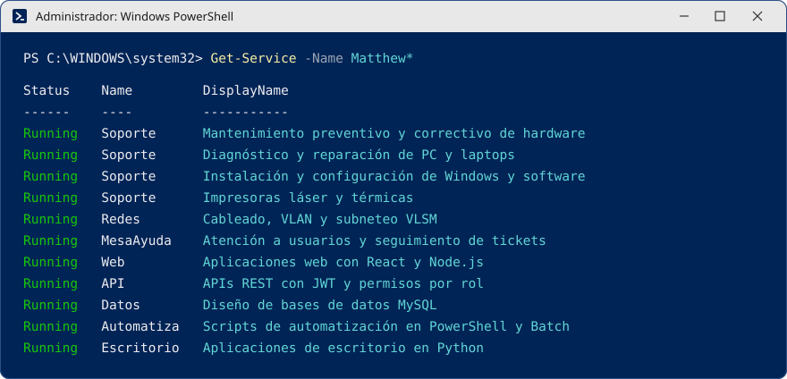
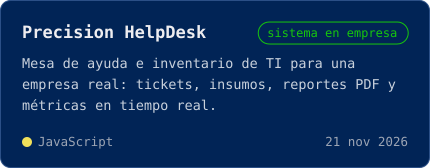
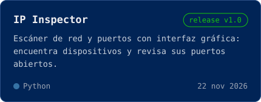
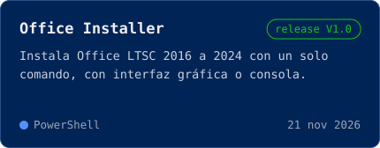
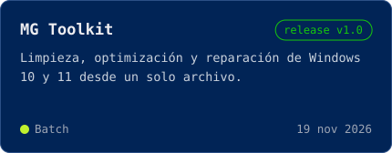
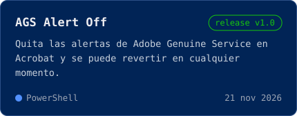
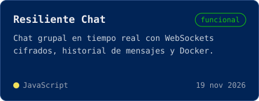
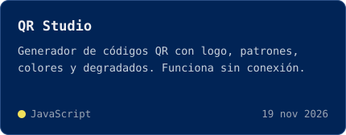
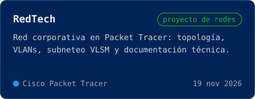
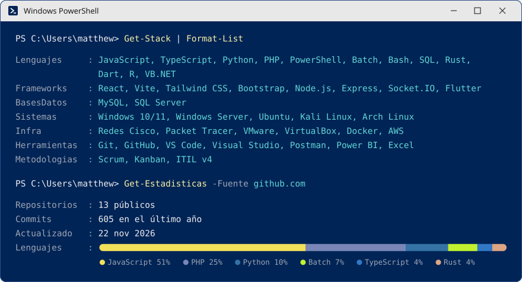

  

  

  

  
  
  
  
  
  
  
  

  <a href="https://matthew-garay.github.io/Microsoft-Office-Installer/">Sitio de Office Installer</a> ·
  <a href="https://matthew-garay.github.io/qr-studio/">Demo de QR Studio</a> ·
  <a href="https://matthew-garay.github.io/CifradoAsimetrico/">Cifrado RSA</a> ·
  <a href="https://github.com/Matthew-Garay/remote-support-app">Remote Support App (en desarrollo)</a>

  

  
  

