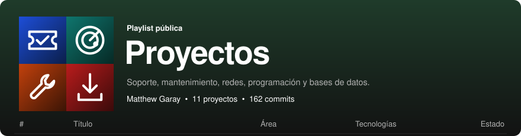
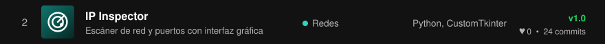
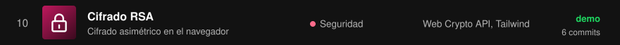
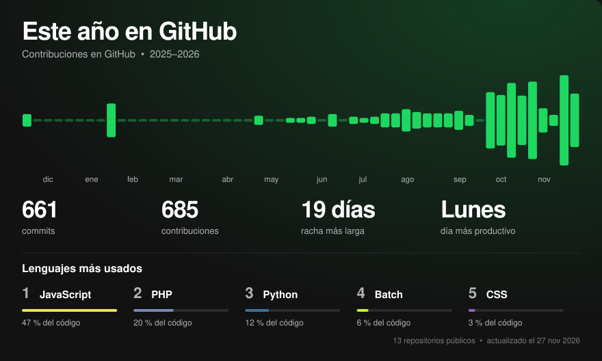

  

  

  

> **Qué resuelve:** el área de TI recibía fallas por mensajes y hojas de cálculo, sin seguimiento ni inventario confiable de equipos.
>
> **Funciones:** tickets con evidencia fotográfica · seguimiento por estado y SLA · inventario de hardware y software · solicitudes de insumos con alertas de stock bajo · manuales PDF · métricas de técnicos (MTTR) · reportes PDF · recuperación de contraseña por correo.
>
> **Tecnologías:** React 18, Vite, Tailwind CSS, Node.js, Express, MySQL (InnoDB, 3FN), Socket.IO, Nodemailer, Sharp, JWT, bcrypt.
>
> **Destacado técnico:** bloqueos `SELECT … FOR UPDATE` para evitar descuentos dobles de inventario con usuarios simultáneos; caché en memoria que baja el dashboard de 85 ms a 3 ms; rate limiting que mantiene el servidor estable a 50 peticiones/s.
>
> **Contexto:** residencia profesional de 500 h en RFV Truck Parts, metodología Scrum y prácticas de ITIL v4. Probado en piloto, incluida una sucursal remota.
>
> [Ver repositorio](https://github.com/Matthew-Garay/Precision-Truck-Parts---Help-Desk)

> **Qué resuelve:** ver qué dispositivos hay en una red local y qué puertos tienen abiertos, sin instalar herramientas complejas.
>
> **Funciones:** descubrimiento por ARP, ICMP y TCP · escaneo de puertos con perfiles (rápido, estándar, completo, IoT/cámaras, personalizado) · identificación de modelo y fabricante por SSDP/UPnP, mDNS y NetBIOS · 18 categorías de dispositivo · mapa de direcciones · detección automática del rango de red · diagnósticos de ping, traceroute, DNS, WHOIS y TLS.
>
> **Tecnologías:** Python 3.10+, CustomTkinter, sockets, multihilo.
>
> **Destacado técnico:** combina varias fuentes de información (puertos, huella del sistema operativo, anuncios de red y fabricante de la MAC) para clasificar cada equipo.
>
> [Ver repositorio](https://github.com/Matthew-Garay/IP-Scanner) · [Descargar](https://github.com/Matthew-Garay/IP-Scanner/releases/latest)

> **Qué resuelve:** reúne en un solo archivo el mantenimiento que hace un técnico: limpiar, acelerar, reparar, buscar virus, respaldar y revisar el equipo.
>
> **Funciones:** 64 herramientas en menú · modo automático o con preguntas · limpieza de temporales y caché · reparación con DISM, SFC y CHKDSK · análisis con Microsoft Defender · puntos de restauración · respaldo de archivos y controladores · instalación de programas con winget · **informe final con puntuación de 0 a 100** y qué falta corregir.
>
> **Tecnologías:** Batch, herramientas nativas de Windows (DISM, SFC, CHKDSK, robocopy, pnputil, winget).
>
> **Destacado técnico:** no instala nada externo ni modifica archivos internos de Windows; funciona de Windows 7 a 11.
>
> [Ver repositorio](https://github.com/Matthew-Garay/MG-Toolkit) · [Descargar](https://github.com/Matthew-Garay/MG-Toolkit/releases/latest)

> **Qué resuelve:** instalar Microsoft Office sin pasos manuales, algo que en soporte se repite en cada equipo.
>
> **Funciones:** Office LTSC 2024, 2021, 2019 y 2016 · interfaz gráfica o de consola · se ejecuta con un solo comando de PowerShell.
>
> **Tecnologías:** PowerShell, HTML (sitio del proyecto).
>
> **Destacado técnico:** sin dependencias externas; todo el despliegue sale de un script.
>
> [Ver repositorio](https://github.com/Matthew-Garay/Microsoft-Office-Installer) · [Sitio web](https://matthew-garay.github.io/Microsoft-Office-Installer/)

> **Qué resuelve:** las ventanas emergentes recurrentes de Adobe Genuine Service que interrumpen el trabajo en Acrobat.
>
> **Funciones:** detiene y deshabilita el servicio `AGSService` · cierra sus procesos · deshabilita sus tareas programadas · tarea diaria y al inicio con cuenta SYSTEM · registro de acciones con rotación.
>
> **Tecnologías:** PowerShell, Programador de tareas de Windows.
>
> **Destacado técnico:** totalmente reversible: guarda la configuración original del servicio y la restaura con `-Uninstall`.
>
> [Ver repositorio](https://github.com/Matthew-Garay/Adobe-Genuine-Service-AGS-Alert) · [Descargar](https://github.com/Matthew-Garay/Adobe-Genuine-Service-AGS-Alert/releases/latest)

> **Qué resuelve:** venta en línea de materiales de construcción con catálogo, carrito y facturación.
>
> **Funciones:** catálogo con filtros por categoría y precio · carrito con sesiones · facturas en HTML enviadas por correo · base de datos de productos, categorías y transacciones.
>
> **Tecnologías:** PHP, MySQL, PHPMailer (SMTP), Bootstrap 5, Tailwind CSS, JavaScript.
>
> **Destacado técnico:** validación de operaciones del carrito con tokens HMAC.
>
> [Ver repositorio](https://github.com/Matthew-Garay/Directo-a-Obra)

> **Qué resuelve:** comunicación grupal en tiempo real cifrada de extremo a servidor.
>
> **Funciones:** WebSockets sobre TLS (WSS) por el puerto 443 · historial de los últimos 50 mensajes · varios usuarios a la vez · interfaz responsiva.
>
> **Tecnologías:** Node.js, Express, WebSockets, Docker.
>
> [Ver repositorio](https://github.com/Matthew-Garay/resiliente-chat)

> **Qué resuelve:** generar códigos QR con diseño propio sin mandar datos a ningún servidor.
>
> **Funciones:** texto, URL, WiFi, vCard, SMS, llamada, correo y WhatsApp · logo, colores, degradados y forma de los módulos · exportación a PNG, JPG, WebP, SVG y PDF en cuatro calidades.
>
> **Tecnologías:** JavaScript, HTML, CSS, Canvas.
>
> **Destacado técnico:** funciona 100 % sin conexión, en el navegador.
>
> [Ver repositorio](https://github.com/Matthew-Garay/qr-studio) · [Probar demo](https://matthew-garay.github.io/qr-studio/)

> **Qué resuelve:** diseño de la red de una empresa ficticia con varias áreas.
>
> **Contenido:** topología completa · segmentación por VLANs · subneteo VLSM · documentación técnica.
>
> **Herramientas:** Cisco Packet Tracer.
>
> [Ver repositorio](https://github.com/Matthew-Garay/Redtech)

> **Qué resuelve:** muestra cómo dos personas se comunican de forma confidencial con claves públicas.
>
> **Funciones:** generación de claves RSA-OAEP · cifrado y descifrado en el navegador · exportación e importación de claves en formato JWK · explicación de Diffie-Hellman.
>
> **Tecnologías:** Web Crypto API, HTML, Tailwind CSS.
>
> [Ver repositorio](https://github.com/Matthew-Garay/CifradoAsimetrico) · [Probar demo](https://matthew-garay.github.io/CifradoAsimetrico/)

> **Qué resuelve:** dar soporte remoto a un equipo, como TeamViewer o AnyDesk. **Está en desarrollo.**
>
> **Diseño:** interfaz en Flutter · núcleo en Rust para captura de pantalla y video H.264 · conexión P2P con WebRTC · servidor de señalización con STUN y TURN · autenticación JWT.
>
> **Tecnologías:** Rust, Flutter, Dart, Actix-web, WebRTC, Docker.
>
> [Ver repositorio](https://github.com/Matthew-Garay/remote-support-app)

 

  

  
  
  
  

  

  

  

  
  
  

Haz clic en un proyecto de la playlist para ver su ficha técnica. Los gráficos se generan con datos reales de GitHub mediante <a href="scripts/generar.py">scripts/generar.py</a>.

